:::::::::::::::::::::::::::::::::::::: questions

- How do we tell whether the sequencing reads are good enough to call variants?
- Do these reads need trimming before alignment?

::::::::::::::::::::::::::::::::::::::::::::::::

::::::::::::::::::::::::::::::::::::: objectives

- Run FastQC and MultiQC in an interactive job.
- Interpret base quality, adapter content, duplication and GC.
- Decide whether trimming is needed before local alignment.

::::::::::::::::::::::::::::::::::::::::::::::::

## Introduction

Before aligning, we check that the reads are what we expect: the right length, good base qualities, few adapters, and nothing strange in their composition. FastQC writes one report per FASTQ file, and MultiQC combines all of them into one page so the samples can be compared side by side.

For variant calling, read QC answers one practical question: is anything wrong with the reads that alignment and calling will not handle by themselves? With modern Illumina data the answer is usually no, and the main risk is the opposite one: removing good data because a QC plot looks unfamiliar.

::::::::::::::::::::::::::::::::::::::: prereq

## Before you start

You need the workshop copy from the setup page and Episode 2 (`$SCRATCH/varcall-workshop/data/` with six FASTQ files).

:::::::::::::::::::::::::::::::::::::::

## Phred scores and binned qualities

The fourth line of each FASTQ record (Episode 2) holds one character per base. Each character encodes the base quality as a Phred score: subtract 33 from the character's ASCII code ([SAM specification](https://samtools.github.io/hts-specs/SAMv1.pdf), which uses the same encoding). A Phred score Q means an estimated error probability of 10^(-Q/10).

Our NovaSeq reads use only four different quality values, a scheme called quality binning. In the first 200,000 reads of the source data we found exactly these characters ([feasibility memo](https://github.com/rcac-bioinformatics/variant-calling/blob/main/maintenance/plan/feasibility.md)):

| Character | ASCII code | Phred score | Estimated error probability |
|---|---|---|---|
| `#` | 35 | 2 | 0.63 |
| `,` | 44 | 11 | 0.08 |
| `:` | 58 | 25 | 0.003 |
| `F` | 70 | 37 | 0.0002 |

::::::::::::::::::::::::::::::::::::::: callout

## Why base quality matters for variant calling

The caller uses base qualities directly. In the genotype likelihoods of Episode 1, a mismatching base with Q37 counts as strong evidence for an ALT allele, and a mismatching base with Q2 counts as almost none. bcftools also adjusts base qualities near indels before calling (base alignment quality, BAQ), so that mismatches caused by misaligned indels count less ([bcftools manual, `mpileup`](https://samtools.github.io/bcftools/bcftools.html#mpileup)). Low-quality bases do not need to be removed for calling to work; they need to be reported honestly, and that is what the quality string does.

:::::::::::::::::::::::::::::::::::::::

## Step 1: Run FastQC in an interactive session

FastQC reads every base of every file, which is too much work for a login node. Start an interactive session on a compute node with 4 cores, then run FastQC on all six files, 4 at a time (`-t 4`):

<!-- kit: interactive 03-qc.sh -->
```bash
sinteractive -A rcac -q standby -p cpu -N 1 -n 4 --time=1:00:00
module load biocontainers
module load fastqc/0.12.1
module load multiqc/1.23
cd $SCRATCH/varcall-workshop
fastqc -t 4 -o results/qc data/*.fastq.gz
```

Starting the session can take a few minutes when the standby queue is busy. FastQC prints its progress for each file; in the workshop's test run, FastQC and MultiQC together took about 4 minutes on 4 cores.

## Step 2: Combine the reports with MultiQC

In the same session, run MultiQC on the FastQC output folder and list what was written:

<!-- kit: interactive 03-qc.sh -->
```bash
multiqc -o results/qc results/qc
ls results/qc
```

::::::::::::::::::::::::::::::::::::: spoiler

## What does the output look like?

```output
       file_search | Search path: /scratch/negishi/aseethar/varcall-kit/kit-runs/kit-2026-10-11/scratch/varcall-workshop/results/qc
            fastqc | Found 6 reports
     write_results | Data        : results/qc/multiqc_data
     write_results | Report      : results/qc/multiqc_report.html
           multiqc | MultiQC complete
HG002_R1_fastqc.html
HG002_R1_fastqc.zip
HG002_R2_fastqc.html
HG002_R2_fastqc.zip
HG003_R1_fastqc.html
HG003_R1_fastqc.zip
HG003_R2_fastqc.html
HG003_R2_fastqc.zip
HG004_R1_fastqc.html
HG004_R1_fastqc.zip
HG004_R2_fastqc.html
HG004_R2_fastqc.zip
multiqc_data
multiqc_report.html
```

MultiQC reports what it found (six FastQC reports) and where it wrote its output. The listing shows one `_fastqc.html` report and one `_fastqc.zip` archive per FASTQ file, plus `multiqc_report.html` and its data folder `multiqc_data/`.

:::::::::::::::::::::::::::::::::::::

Type `exit` to leave the interactive session when you are done. To read the report, copy `results/qc/multiqc_report.html` to your computer (for example with `scp`, or the file browser in MobaXterm) and open it in a web browser.

::::::::::::::::::::::::::::::::::::::: callout

## Short on time?

If your FastQC session did not finish, the completed reports are in the results copy. Open the MultiQC report from there instead of your own:

<!-- kit: not-run fallback -->
```bash
cp /depot/workshop/data/varcall-workshop_results/results/qc/multiqc_report.html $SCRATCH/varcall-workshop/results/qc/
```

Nothing later in the workshop reads the QC reports, so you can continue with Episode 4 either way.

:::::::::::::::::::::::::::::::::::::::

## Step 3: Read the report

FastQC marks each module with a pass, warning or fail. These marks come from thresholds designed for a generic whole-genome library ([FastQC documentation](https://www.bioinformatics.babraham.ac.uk/projects/fastqc/)); read the plots, not only the colors. Below, each module is described with what to expect from this dataset, followed by a schematic cartoon that shows what a problem looks like. The cartoons are not this workshop's data.

### Per base sequence quality

The distribution of base qualities at each position along the read. With binned qualities, the box plots in each FastQC report look blocky: medians, quartiles and percentiles can only take the four values (2, 11, 25, 37). That is binning, not a failure. In our files the median and both quartiles are 37 at every position; only the 10th percentile drops, to 25, the next bin down, over the last part of the read (from position 125 in R1, and from position 85 to 95 in R2, depending on the sample). Values between the bins, such as 27.4, 29.8, 32.2 and 34.6, are not qualities in the data: for reads longer than 50 bp FastQC groups neighboring positions (the `--nogroup` option of the [FastQC program](https://github.com/s-andrews/FastQC/blob/master/fastqc) turns this off) and reports one value per group, the average over its positions. A group of five positions with the 10th percentile at 37 in three and at 25 in two shows 32.2. MultiQC plots the mean, which stays near 35 to 36 and falls slightly over the last cycles.

<div class="figure" style="text-align: center">
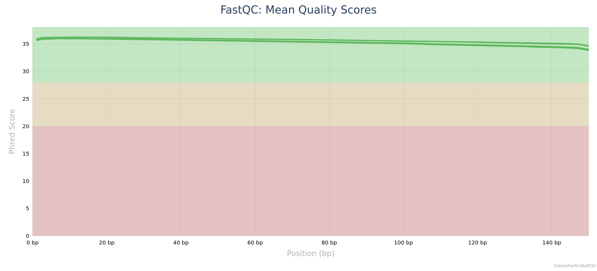
<p class="caption">Your output: mean base quality at each position of the six workshop FASTQ files (MultiQC). The means stay between about Q34 and Q36 along the whole 151 bp read.</p>
</div>

<div class="figure" style="text-align: center">
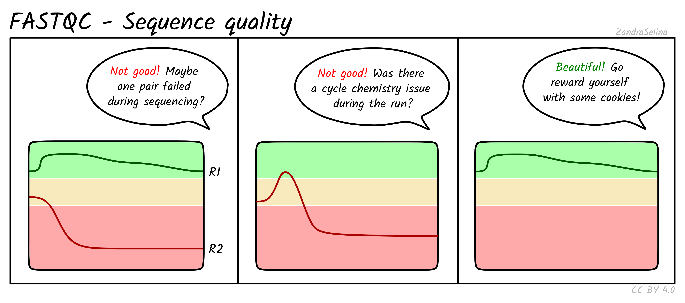
<p class="caption">Contrast example, schematic and not data: one read of a pair failing, a chemistry problem during the run, and a good profile. Cartoon by Zandra Selina, CC BY 4.0.</p>
</div>

### Per sequence quality scores

The mean quality of each read, as a histogram. A good run has one sharp peak at high quality.

<div class="figure" style="text-align: center">
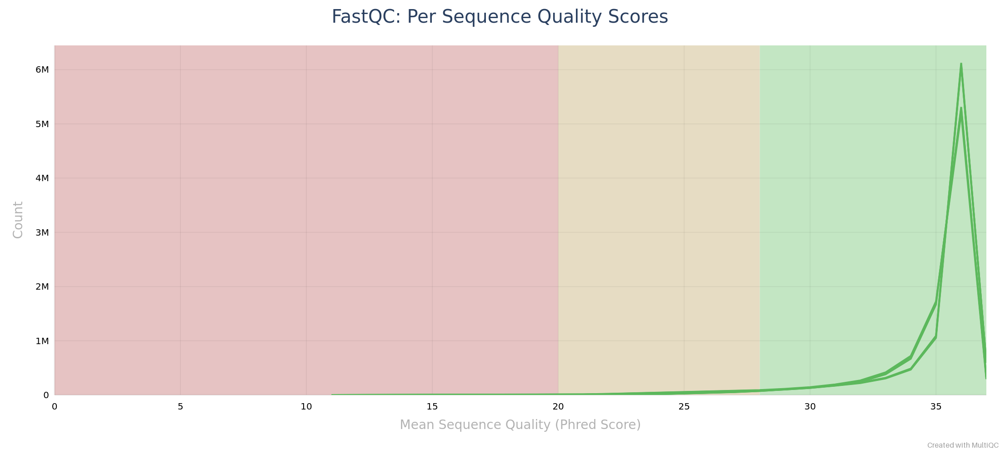
<p class="caption">Your output: mean quality per read for the six workshop FASTQ files (MultiQC). Most reads have a high mean quality, with a sharp peak at 36.</p>
</div>

<div class="figure" style="text-align: center">
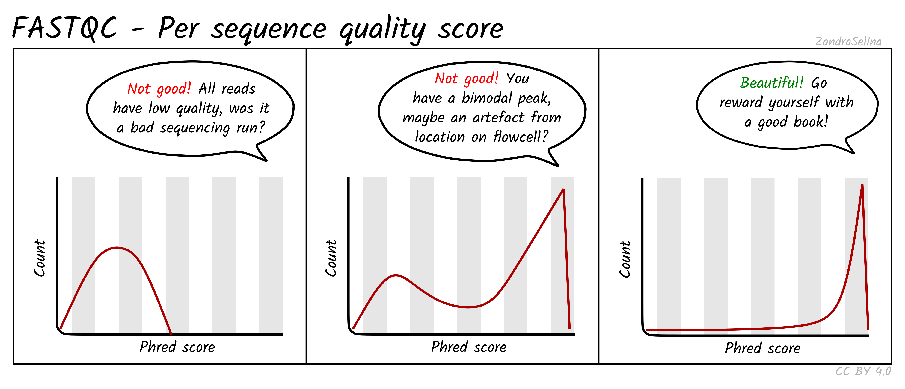
<p class="caption">Contrast example, schematic and not data: most reads of low quality (a bad run), a bimodal distribution (often a flowcell location artifact), and a good single peak at high quality. Cartoon by Zandra Selina, CC BY 4.0.</p>
</div>

### Per sequence GC content

The GC fraction of each read, compared with a theoretical distribution. Two separate peaks, or a sharp spike, can mean contamination from another organism or an overrepresented sequence. FastQC warns when the curve departs from the smooth normal shape it expects. Our six files peak near 40% GC with a shoulder near 50%, and FastQC warns for all six. The curves are the same in every file, which points to the composition of the sequenced region (all reads come from chromosome 20) rather than to contamination, which would differ between samples or add a separate peak.

<div class="figure" style="text-align: center">
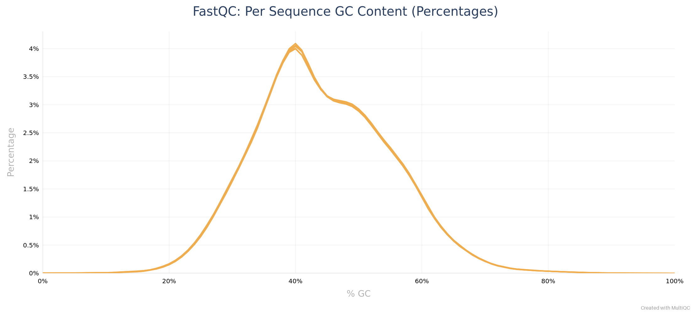
<p class="caption">Your output: GC content per read for the six workshop FASTQ files (MultiQC). All six curves overlap: a peak near 40% GC with a shoulder near 50%.</p>
</div>

<div class="figure" style="text-align: center">
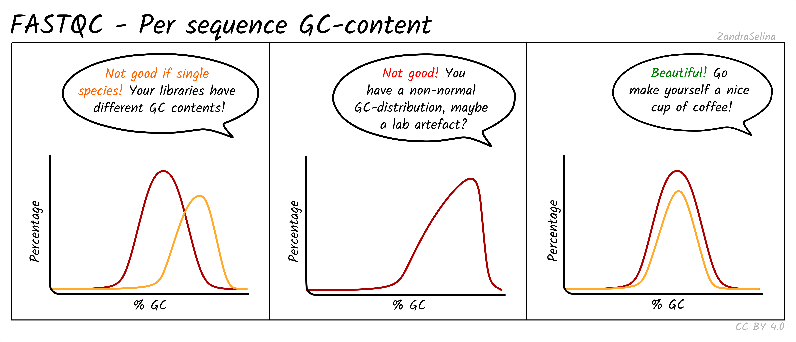
<p class="caption">Contrast example, schematic and not data: libraries with different GC content (fine across species, a warning within one), a non-normal distribution that suggests a lab artifact, and a good match to the expected curve. Cartoon by Zandra Selina, CC BY 4.0.</p>
</div>

### Per base N content

The fraction of bases the sequencer could not call (`N`) at each position. It should be near zero everywhere.

<div class="figure" style="text-align: center">
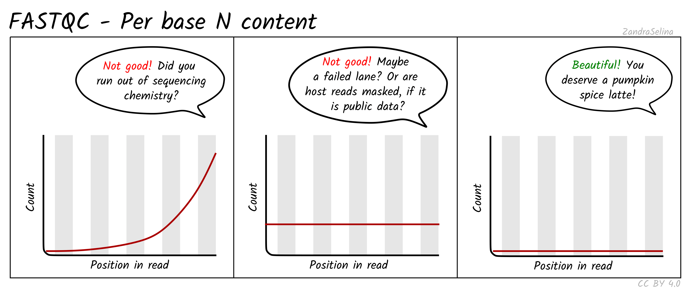
<p class="caption">Contrast example, schematic and not data: N bases rising toward the end of the read (chemistry running out), a constant N level (a failed lane or masked reads), and no N bases. Cartoon by Zandra Selina, CC BY 4.0.</p>
</div>

### Sequence duplication levels

How many reads have exactly the same sequence as another read. FastQC estimates this from the first reads of each file and from read 1 or read 2 alone, so it is only a rough guide. The duplicate rate that matters for calling is measured after alignment, from read pairs, in Episode 4.

Duplicates have two main sources: PCR amplification during library preparation, and the sequencer itself, when one DNA fragment is read in more than one cluster (optical duplicates; the [samtools markdup manual](https://www.htslib.org/doc/samtools-markdup.html) describes how they are detected). Our libraries are PCR-free, which removes most of the first kind, but not the second.

<div class="figure" style="text-align: center">
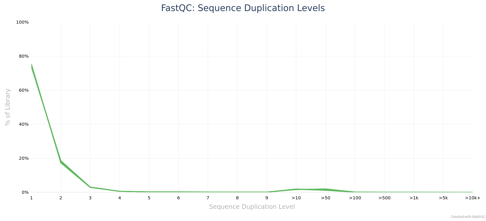
<p class="caption">Your output: sequence duplication levels for the six workshop FASTQ files (MultiQC). About three quarters of the reads occur once, and most of the rest twice.</p>
</div>

<div class="figure" style="text-align: center">
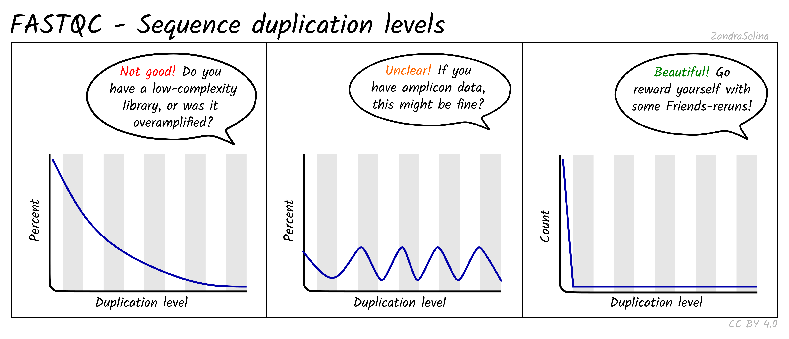
<p class="caption">Contrast example, schematic and not data: high duplication from a low-complexity or over-amplified library, a periodic pattern that can be fine for amplicon data, and a library dominated by unique reads. Cartoon by Zandra Selina, CC BY 4.0.</p>
</div>

### Adapter content

The fraction of reads that contain adapter sequence at each position. Adapters appear when a DNA fragment is shorter than the read length, so the sequencer reads past the end of the fragment into the adapter. Our fragments average about 400 bp (the insert sizes of the source alignments were 399.5 to 417.9 bp on average; feasibility memo), well above the 151 bp read length, so few reads should reach the adapter. FastQC 0.12 also counts poly-A and poly-G stretches in this module, and reports each adapter type as its own line. Its poly-A series counts reads that contain 12 A's in a row (FastQC's [adapter list](https://github.com/s-andrews/FastQC/blob/master/Configuration/adapter_list.txt)). Such runs also occur in the genome itself, and every read here came from an alignment to chromosome 20, so the poly-A series does not point to a library artifact and is no reason to trim.

<div class="figure" style="text-align: center">
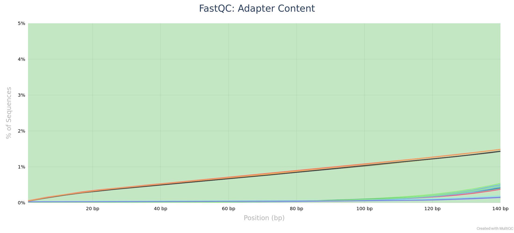
<p class="caption">Your output: adapter content for the six workshop FASTQ files (MultiQC). Every line stays below 1.5% of reads; the highest lines are FastQC's poly-A series, and the Illumina Universal Adapter stays at or below 0.54%.</p>
</div>

<div class="figure" style="text-align: center">
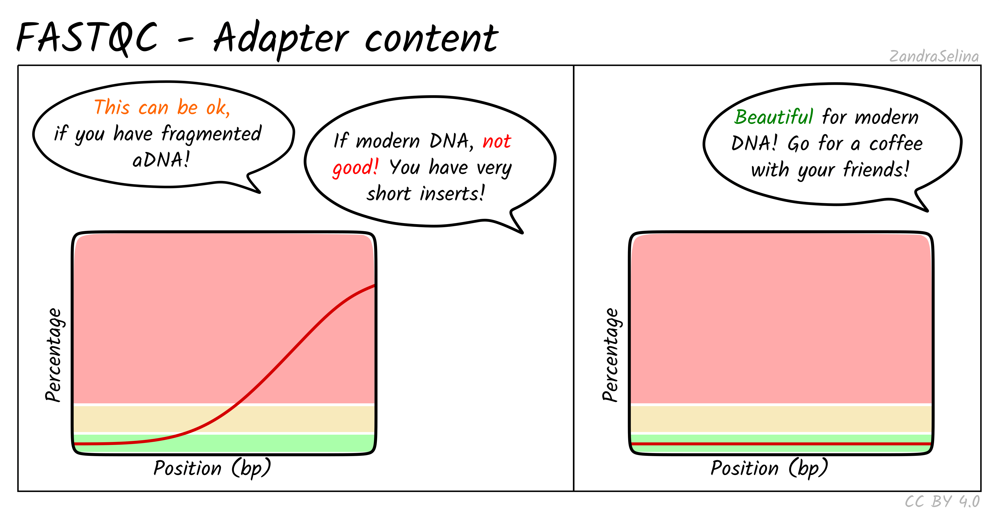
<p class="caption">Contrast example, schematic and not data: adapter content rising toward the read end (short inserts, acceptable only for fragmented ancient DNA) and a flat line near zero. Cartoon by Zandra Selina, CC BY 4.0.</p>
</div>

::::::::::::::::::::::::::::::::::::::: callout

## Why these reports look clean

Our reads were selected from alignments to chromosome 20 (Episode 2; [feasibility memo](https://github.com/rcac-bioinformatics/variant-calling/blob/main/maintenance/plan/feasibility.md)). Pairs that aligned nowhere, such as adapter dimers or reads of a single repeated base, were never in those alignments, so they are largely absent from our FASTQ files. The QC of a raw sequencing run of the same libraries would look less clean than these reports.

:::::::::::::::::::::::::::::::::::::::

::::::::::::::::::::::::::::::::::::::: challenge

## Challenge: interpret the QC report

Using your MultiQC report (or the one from the results copy):

1. How many reads does each file have, and are R1 and R2 of each sample equal?
2. Which FastQC modules are not marked "pass" in at least one file? For each, decide whether it points to a problem for variant calling.
3. Is there enough adapter sequence to justify trimming?
4. What does FastQC report for duplication, and how does that compare with the duplicate rate after alignment that Episode 4 reports?

::::::::::::::::::::::::::::::::::: solution

1. HG002 has 9,462,450 reads in R1 and in R2, HG003 9,480,040 and HG004 9,347,118. R1 and R2 of a sample must have the same number of reads, because each read pair contributes one read to each file.
2. Only one module is not marked pass: Per sequence GC content, a warning in all six files. The curves have a shoulder near 50% GC and are identical across files, so this reflects the sequence of chromosome 20, not a problem with the libraries. It is not a reason to change anything for variant calling.
3. No. Adapter Content passes in all six files. The Illumina Universal Adapter reaches at most 0.37% to 0.54% of reads per file, at the read end; the highest lines, 1.43% to 1.49%, are FastQC's poly-A series. With fragments averaging about 400 bp and 151 bp reads, adapter read-through is rare, and the aligner handles the few reads that have it (next section). No trimming is needed.
4. FastQC reports that 84.3% to 85.3% of reads would remain after removing duplicates ("Total Deduplicated Percentage"), so it estimates 14.7% to 15.7% duplicates per file. After alignment, `samtools markdup` flags 10.4% to 11.0% of the reads as duplicates (Episode 4). The two numbers measure different things: FastQC compares single reads by sequence, `markdup` compares read pairs by alignment position.

:::::::::::::::::::::::::::::::::::

:::::::::::::::::::::::::::::::::::::::

## Step 4: Decide whether to trim

Trimming removes adapter sequence and low-quality ends from reads before alignment. For variant calling with `bwa mem`, it is usually unnecessary:

- **`bwa mem` performs local alignment.** It aligns the part of a read that matches the genome and **soft-clips** the rest: the clipped bases stay in the file but are not aligned and do not count as mismatches ([bwa manual](https://bio-bwa.sourceforge.net/bwa.shtml)). Adapter sequence at a read end is clipped this way.
- **Base qualities already carry the uncertainty.** The caller down-weights low-quality bases (callout above), so cutting them off gains little.
- **Trimming has costs.** Shorter reads map less uniquely, uneven trimming creates differences between samples, and it adds parameters that must be recorded to reproduce the analysis.

Trim when QC shows a real problem that the aligner cannot absorb: many short inserts with adapter in a large fraction of reads, a failed stretch of cycles, or a library type that needs it (for example, some amplicon and small-RNA protocols).

::::::::::::::::::::::::::::::::::::::: discussion

## Discussion: when would you trim?

Your own data shows adapter content rising to 30% of reads at the 3' end, and a median insert size of 120 bp with 150 bp reads. Would you trim before running `bwa mem`? What would you check after alignment to confirm your choice?

:::::::::::::::::::::::::::::::::::::::

:::::::::::::::::::::::::::::::::::::::::: spoiler

## Trimming with fastp (reference only)

*Optional reference: not part of the hands-on, and not tested by the workshop's run kit.* If your data does need trimming, [fastp](https://github.com/OpenGene/fastp) detects and removes adapters, trims low-quality ends, keeps read pairs in sync and writes a QC report:

<!-- kit: not-run reference -->
```bash
module load biocontainers
module load fastp/0.23.2
fastp \
  -i sample_R1.fastq.gz \
  -I sample_R2.fastq.gz \
  -o sample_R1.trimmed.fastq.gz \
  -O sample_R2.trimmed.fastq.gz \
  --detect_adapter_for_pe \
  --thread 8 \
  --html sample.fastp.html \
  --json sample.fastp.json
```

Run it in a batch job or an interactive session, never on a login node. Rerun FastQC on the trimmed files, and record the fastp version and options with your results.

::::::::::::::::::::::::::::::::::::::::::

## Summary

::::::::::::::::::::::::::::::::::::: keypoints

- Base qualities are Phred scores; our NovaSeq reads use only four binned values (2, 11, 25, 37), which makes quality plots look blocky without indicating a problem.
- FastQC and MultiQC summarize read quality; run them in an interactive job, not on a login node.
- Pass, warn and fail marks come from generic thresholds; interpret each plot for your data type.
- The caller uses base qualities directly, so low-quality bases are down-weighted rather than removed.
- `bwa mem` soft-clips adapters and poor read ends, so trimming is usually unnecessary for these data.

::::::::::::::::::::::::::::::::::::::::::::::::
