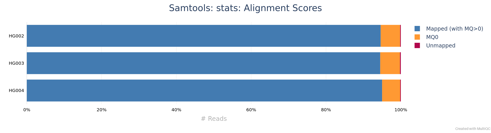
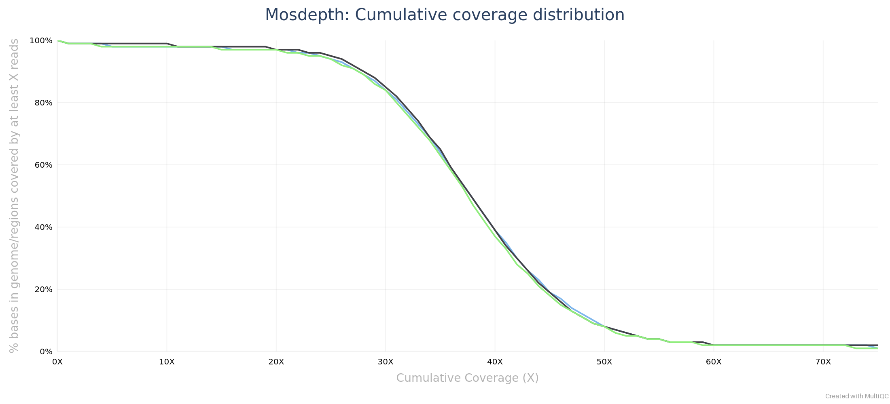

:::::::::::::::::::::::::::::::::::::: questions

- How are reads placed on the reference genome?
- Why does mapping quality matter for variant calling?
- How do we produce analysis-ready BAM files on the cluster?
- How do we know the alignment worked?

::::::::::::::::::::::::::::::::::::::::::::::::

::::::::::::::::::::::::::::::::::::: objectives

- Explain why mapping quality matters for calling.
- Align with `bwa mem` using correct read groups.
- Produce sorted, duplicate-marked and indexed BAMs.
- Read SAM fields (FLAG, CIGAR, MAPQ).
- Interpret mapping, pairing, duplicate, insert-size and coverage metrics.
- View a locus.

::::::::::::::::::::::::::::::::::::::::::::::::

## Introduction

A caller can only be as good as the alignments it reads. In this episode we align the reads of all three samples to GRCh38 with `bwa mem`, mark duplicate reads, and write sorted, indexed BAM files. Then we check the alignments: how many reads mapped, how many in proper pairs, how many duplicates, how deep the coverage is, and what the reads look like at one variant.

Alignment is the longest job of the day, so we start it first and take the script apart while it runs.

::::::::::::::::::::::::::::::::::::::: prereq

## Before you start

You need the workshop copy from Episode 2: the FASTQ files in `data/`, the sample sheet `data/samples.tsv`, the reference links in `ref/`, and the script `scripts/align.sh`. Episode 3 is not required.

:::::::::::::::::::::::::::::::::::::::

## Step 1: Submit the alignment job

The alignment script is already in your `scripts/` folder. Submit it now from that folder; the next sections explain every line while it runs:

<!-- kit: submit align.sh -->
```bash
cd $SCRATCH/varcall-workshop/scripts
sbatch align.sh
```

`sbatch` prints a job ID. The script is an array job with three tasks, one per sample, and each task uses 16 cores. In the workshop's test runs each task took 10 to 14 minutes, plus the time waiting in the standby queue. Check on it with:

<!-- kit: not-run monitoring -->
```bash
squeue -u $USER
```

Each task writes its log to `scripts/cluster-align.<jobid>.out` and `.err`. When `squeue` no longer lists the job, it has finished.

::::::::::::::::::::::::::::::::::::: instructor

Pacing (plan section 4): have learners submit `align.sh` at the end of the Episode 2-3 block, before the morning break, so the jobs run during the break. Episode 4 then dissects the script while the jobs finish. If learners submit only now, the explanation sections below still cover the run time.

:::::::::::::::::::::::::::::::::::::::::::::::::

::::::::::::::::::::::::::::::::::::::: callout

## Short on time?

If your alignment job fails or is still waiting when we reach Step 3, copy the finished BAM files, their indexes and the duplicate statistics from the results copy into your own `results/bam/` (about 3.2 GB):

<!-- kit: not-run fallback -->
```bash
cp /depot/workshop/data/varcall-workshop_results/results/bam/HG00?.markdup.bam* $SCRATCH/varcall-workshop/results/bam/
cp /depot/workshop/data/varcall-workshop_results/results/bam/HG00?.markdup.stats.txt $SCRATCH/varcall-workshop/results/bam/
```

Cancel your own job first (`scancel <jobid>`), so it does not overwrite the copies. Episodes 5A onward work the same with either set of BAMs.

:::::::::::::::::::::::::::::::::::::::

## How short-read alignment works

An aligner has to find, for each of millions of reads, the place in a 3.1 Gb genome where it fits best, allowing for sequencing errors and real variants. Checking every position for every read would take far too long, so `bwa mem` uses **seed and extend**: it first finds exact matches between the read and the genome (seeds) using an index of the reference, and then extends the best seeds into a full alignment that may contain mismatches and gaps ([bwa manual](https://bio-bwa.sourceforge.net/bwa.shtml)).

`bwa mem` aligns locally: if the end of a read does not match, for example because it runs into adapter sequence or crosses a structural variant, that end is **soft-clipped**, kept in the file but not aligned. With paired reads, it also uses the expected distance and orientation of the two mates to choose between candidate positions and to rescue a mate that did not align well on its own.

### Mapping quality and multi-mapping reads

Some reads fit equally well in several places, for example inside a repeat. The aligner then picks one of the equally good positions and reports how unsure it is as the **mapping quality** (MAPQ): the Phred-scaled probability that the position is wrong ([SAM specification](https://samtools.github.io/hts-specs/SAMv1.pdf)). A read with several equally good positions gets MAPQ 0: the position written in the file is one guess among them.

This is why mapping quality matters for calling. If a read from one copy of a repeat is placed on another copy, every difference between the two copies looks like a variant at the wrong place. Callers down-weight or skip low-MAPQ reads, and Episode 6 filters sites whose reads have low average mapping quality.

## The reference index

`bwa mem` needs the reference in its own index format: the five files `GRCh38_no_alt.fa.amb`, `.ann`, `.bwt`, `.pac` and `.sa` in `ref/`. NCBI publishes this index for the no-alt analysis set, and it loads in bwa 0.7.17, so we did not build it ([feasibility memo](https://github.com/rcac-bioinformatics/variant-calling/blob/main/maintenance/plan/feasibility.md)). Unpacked, it is 5.42 GB.

The index is loaded into memory by every alignment task. On Negishi, memory comes with the cores you request, about 1.9 GB per core; there is no separate memory request in our scripts. The 16 cores of each task bring enough memory for the index and the sorting step: in the reference run, the largest task used 13.5 GiB.

::::::::::::::::::::::::::::::::::::: spoiler

## How would I build an index for another genome?

*Reference only: do not run this on the workshop reference.*

For your own organism, build the index once from its FASTA file, in a batch job, and keep it with the reference:

<!-- kit: not-run reference -->
```bash
module load biocontainers
module load bwa/0.7.17
bwa index my_genome.fa
```

This writes the same five files next to `my_genome.fa`. For a genome the size of human it is a long, memory-hungry job, which is why we use the published index. Index files only work with the FASTA they were built from: if you change the FASTA (for example, rename a sequence), build the index again.

:::::::::::::::::::::::::::::::::::::

## Step 2: The alignment script, line by line

This is `scripts/align.sh` as you submitted it:

<!-- kit: script align.sh -->
```bash
#!/bin/bash
#SBATCH --nodes=1
#SBATCH --ntasks=1
#SBATCH --cpus-per-task=16
#SBATCH --account=rcac
#SBATCH --qos=standby
#SBATCH --partition=cpu
#SBATCH --time=01:00:00
#SBATCH --job-name=align
#SBATCH --array=1-3
#SBATCH --output=cluster-%x.%j.out
#SBATCH --error=cluster-%x.%j.err

module load biocontainers
module load bwa/0.7.17
module load samtools/1.22.1

WORK=$SCRATCH/varcall-workshop
REF=$WORK/ref/GRCh38_no_alt.fa
OUTDIR=$WORK/results/bam
mkdir -p $OUTDIR

# One sample per array task: task N reads line N+1 of samples.tsv (line 1 is the header)
LINE=$(sed -n "$((SLURM_ARRAY_TASK_ID + 1))p" $WORK/data/samples.tsv)
IFS=$'\t' read -r SAMPLE ROLE SEX FAMILY FASTQ_R1 FASTQ_R2 RG_ID RG_LB RG_PL <<< "$LINE"

# Read group: SM becomes the sample name in the VCF. Keep \t as typed; bwa turns it into tabs.
RG="@RG\tID:${RG_ID}\tSM:${SAMPLE}\tLB:${RG_LB}\tPL:${RG_PL}"

# -K 100000000 makes the alignments identical for any number of threads
bwa mem -K 100000000 -t $SLURM_CPUS_PER_TASK -R "$RG" $REF \
    $WORK/data/$FASTQ_R1 $WORK/data/$FASTQ_R2 \
  | samtools fixmate -m -u - - \
  | samtools sort -u -@ 4 -m 1500M -T $OUTDIR/${SAMPLE}.sorttmp - \
  | samtools markdup -@ 4 --write-index -f $OUTDIR/${SAMPLE}.markdup.stats.txt \
      -T $OUTDIR/${SAMPLE}.mdtmp - $OUTDIR/${SAMPLE}.markdup.bam
```

### The SLURM header

The `#SBATCH` lines request one node, 16 cores (`--cpus-per-task=16`) and one hour, on the `cpu` partition with the standby QoS, under the workshop account. `--array=1-3` turns the script into three tasks, numbered 1, 2 and 3, that run independently; inside each task, `$SLURM_ARRAY_TASK_ID` holds its number. Logs go to `cluster-<jobname>.<jobid>.out` and `.err` in the folder you submitted from.

### One sample per task

`sed -n "$((SLURM_ARRAY_TASK_ID + 1))p"` prints one line of `samples.tsv`: line 2 for task 1, because line 1 is the header. `IFS=$'\t' read -r ...` then splits that line at tabs into named variables, one per column. Task 1 aligns the first sample in the sheet, task 2 the second, and so on, so the sheet decides which sample each task processes.

The path to the sheet is absolute (`$WORK/data/samples.tsv`). A script that reads `samples.tsv` relative to the current folder works only when it is submitted from the folder that contains the sheet, and fails, or reads the wrong file, from anywhere else.

### Read groups

A **read group** labels a set of reads that were sequenced together. `bwa mem -R` adds a header line (`@RG`) to the BAM file and tags every read with its ID. The fields we set are defined in the [SAM specification](https://samtools.github.io/hts-specs/SAMv1.pdf):

| Field | Meaning | Value here |
|---|---|---|
| `ID` | unique identifier of the read group | `rg_id` from the sample sheet |
| `SM` | sample name | the sample, for example `HG002` |
| `LB` | library | `rg_lb` from the sample sheet |
| `PL` | sequencing platform | `ILLUMINA` |

`SM` matters most: bcftools takes the sample names of the VCF from the `SM` field of the read groups, so every BAM must carry the right one. Reads with the same `SM` are treated as one sample, even if they are in different files.

The `\t` in the `RG=` line is typed as a backslash and a `t`, not as a real tab. `bwa` converts each `\t` into a tab when it writes the header. Real tab characters in the `-R` argument, or a missing `ID` or `SM`, make `bwa` stop with an error.

### `bwa mem`

- `-K 100000000` makes `bwa mem` process input in batches of a fixed size (100 million bases) regardless of the number of threads. Without it, the batch size depends on the thread count, and so can the results ([bwa manual](https://bio-bwa.sourceforge.net/bwa.shtml)). The reference run checked this: HG002 aligned at 16 and at 32 cores gave identical alignments.
- `-t $SLURM_CPUS_PER_TASK` uses all 16 cores of the task.
- The output is SAM text, written to standard output and piped (`|`) straight into the next command. No large intermediate file is written.

### `samtools fixmate -m`, then `sort`, then `markdup`

The three samtools steps follow the order the [samtools markdup manual](https://www.htslib.org/doc/samtools-markdup.html) requires:

1. **`samtools fixmate -m`** fills in information about each read's mate, including the mate score tag that `markdup` needs (added by `-m`). It must see the two reads of a pair next to each other. `bwa mem` writes pairs together, so its output can go straight into `fixmate`; a coordinate-sorted file would first need `samtools collate`.
2. **`samtools sort`** sorts by position on the genome, which callers and viewers need. `-@ 4` adds 4 threads, `-m 1500M` lets each thread use up to 1.5 GB of memory before writing temporary files, and `-T` names those temporary files.
3. **`samtools markdup`** finds duplicates in the sorted file, flags them, writes the final BAM, and, with `--write-index`, its index. `-f` writes a short statistics file.

`-u` passes uncompressed data between the steps, which saves the time of compressing and decompressing data that is read again immediately. The `-` arguments mean standard input or standard output. Sorting before `fixmate` is a common mistake: `fixmate` needs the two reads of each pair next to each other, and in a position-sorted file it cannot pair them, so the mate information `markdup` relies on is missing or wrong.

::::::::::::::::::::::::::::::::::::::: callout

## Why mark duplicates, and why not remove them?

Duplicates are copies of one original DNA fragment. If one fragment carries a sequencing error and is read several times, the error appears in several reads and looks like independent support for a variant. Marking duplicates lets the caller count each fragment once.

`samtools markdup` flags duplicates (FLAG bit 1024) and keeps them in the file. bcftools skips flagged duplicates by default ([bcftools manual, `mpileup`](https://samtools.github.io/bcftools/bcftools.html#mpileup)), and the reads are still there if you need them, for example to inspect a site or recount. The old `samtools rmdup` command removes reads instead; use `markdup` ([samtools manual](https://www.htslib.org/doc/samtools.html)).

:::::::::::::::::::::::::::::::::::::::

::::::::::::::::::::::::::::::::::::::: challenge

## Challenge: what if the read groups are wrong?

1. Suppose `samples.tsv` listed `HG002` in the `sample` column of all three rows. The script would still run without error. What would the VCF in Episode 5A look like?
2. Why does the script write the read group from the sample sheet instead of having you type it for each sample?

::::::::::::::::::::::::::::::::::: solution

1. All three BAMs would carry `SM:HG002`, so bcftools would treat all reads as one sample. The VCF would have one sample column, `HG002`, with the reads of three people pooled: about 116x of mixed evidence and genotypes that belong to nobody. Nothing would fail, which is what makes this error dangerous. Check the `@RG` lines after alignment (Step 3 does).
2. One source of truth: the sample name, file names and read group come from the same row, so they cannot disagree, and the sheet is a record of what was done. Typing them per sample is where mistakes come from.

:::::::::::::::::::::::::::::::::::

:::::::::::::::::::::::::::::::::::::::

## SAM and BAM

The aligner writes **SAM**, a tab-separated text format with a header (lines starting with `@`) and one line per alignment. **BAM** is the same content, compressed in blocks so it can be indexed for fast access to any region; that is what we keep. **CRAM** compresses further by storing only differences from the reference, and so needs the exact reference FASTA to be read back ([htslib file formats](https://samtools.github.io/hts-specs/)).

Each alignment line has 11 mandatory columns ([SAM specification](https://samtools.github.io/hts-specs/SAMv1.pdf)):

| Column | Name | Meaning |
|---|---|---|
| 1 | QNAME | read name (both reads of a pair share it) |
| 2 | FLAG | properties of the read, as a sum of bit values |
| 3 | RNAME | reference sequence name, for example `chr20` |
| 4 | POS | 1-based position of the leftmost aligned base |
| 5 | MAPQ | mapping quality |
| 6 | CIGAR | how the read aligns: `M` aligned (match or mismatch), `I` insertion, `D` deletion, `S` soft clip, `H` hard clip |
| 7 | RNEXT | reference name of the mate (`=` for the same) |
| 8 | PNEXT | position of the mate |
| 9 | TLEN | observed template (fragment) length |
| 10 | SEQ | read sequence |
| 11 | QUAL | base qualities, as in FASTQ |

For example, the CIGAR `100M2D51M` means 100 aligned bases, a 2 bp deletion in the read relative to the reference, then 51 aligned bases. `20S131M` means the first 20 bases are soft-clipped.

The FLAG is a sum of bits, each with a meaning. The ones you meet most often:

| Bit | Meaning |
|---|---|
| 1 | read is paired |
| 2 | read is in a proper pair |
| 4 | read is unmapped |
| 16 | read is reverse-complemented |
| 32 | mate is reverse-complemented |
| 64 | first read of the pair |
| 128 | second read of the pair |
| 256 | secondary alignment |
| 1024 | duplicate |
| 2048 | supplementary alignment |

## Step 3: Check the alignments

When `squeue` shows that your alignment job has finished, start an interactive session and load the QC tools. List the output files first:

<!-- kit: interactive 04-alignment-qc.sh -->
```bash
sinteractive -A rcac -q standby -p cpu -N 1 -n 4 --time=1:00:00
module load biocontainers
module load samtools/1.22.1
module load mosdepth/0.3.3
module load multiqc/1.23
cd $SCRATCH/varcall-workshop
ls -lh results/bam
```

::::::::::::::::::::::::::::::::::::: spoiler

## What does the output look like?

```output
total 3.1G
-rw-r--r-- 1 aseethar workshop  1.1G Oct 10 21:35 HG002.markdup.bam
-rw-r--r-- 1 aseethar workshop  249K Oct 10 21:35 HG002.markdup.bam.csi
-rw-r--r-- 1 aseethar workshop   769 Oct 10 21:35 HG002.markdup.stats.txt
-rw-r--r-- 1 aseethar workshop  1.1G Oct 10 21:32 HG003.markdup.bam
-rw-r--r-- 1 aseethar workshop  248K Oct 10 21:32 HG003.markdup.bam.csi
-rw-r--r-- 1 aseethar workshop   770 Oct 10 21:32 HG003.markdup.stats.txt
-rw-r--r-- 1 aseethar workshop 1015M Oct 10 21:31 HG004.markdup.bam
-rw-r--r-- 1 aseethar workshop  247K Oct 10 21:31 HG004.markdup.bam.csi
-rw-r--r-- 1 aseethar workshop   769 Oct 10 21:31 HG004.markdup.stats.txt
```

Each sample has a BAM file (about 1 GB), its `.csi` index and the duplicate statistics from `markdup`. `samtools markdup --write-index` writes a CSI index rather than the older `.bai` format; samtools, bcftools and mosdepth read both.

:::::::::::::::::::::::::::::::::::::

Now compute three sets of metrics for each sample: `samtools flagstat` (counts by FLAG), `samtools stats` (detailed statistics) and `mosdepth` (coverage). This takes about 3 minutes for the three samples:

<!-- kit: interactive 04-alignment-qc.sh -->
```bash
for SAMPLE in HG002 HG003 HG004; do
    samtools flagstat -@ 4 results/bam/$SAMPLE.markdup.bam > results/qc_alignment/$SAMPLE.flagstat.txt
    samtools stats -@ 4 results/bam/$SAMPLE.markdup.bam > results/qc_alignment/$SAMPLE.stats.txt
    mosdepth -t 4 -n --fast-mode -c chr20 results/qc_alignment/$SAMPLE results/bam/$SAMPLE.markdup.bam
done
```

For `mosdepth`, `-c chr20` restricts the calculation to chromosome 20, `-n` skips the per-base output file, and `--fast-mode` skips the correction for overlapping mates and the details of each CIGAR, which the [mosdepth documentation](https://github.com/brentp/mosdepth) recommends for most uses.

::::::::::::::::::::::::::::::::::::::: callout

## Short on time?

If the metrics are not ready, copy them from the results copy:

<!-- kit: not-run fallback -->
```bash
cp /depot/workshop/data/varcall-workshop_results/results/qc_alignment/HG00?.* $SCRATCH/varcall-workshop/results/qc_alignment/
```

:::::::::::::::::::::::::::::::::::::::

### Read counts by flag

<!-- kit: interactive 04-alignment-qc.sh -->
```bash
cat results/qc_alignment/HG002.flagstat.txt
```

::::::::::::::::::::::::::::::::::::: spoiler

## What does the output look like?

```output
18980761 + 0 in total (QC-passed reads + QC-failed reads)
18924900 + 0 primary
0 + 0 secondary
55861 + 0 supplementary
1975897 + 0 duplicates
1975897 + 0 primary duplicates
18944359 + 0 mapped (99.81% : N/A)
18888498 + 0 primary mapped (99.81% : N/A)
18924900 + 0 paired in sequencing
9462450 + 0 read1
9462450 + 0 read2
18759278 + 0 properly paired (99.12% : N/A)
18852096 + 0 with itself and mate mapped
36402 + 0 singletons (0.19% : N/A)
6198 + 0 with mate mapped to a different chr
1177 + 0 with mate mapped to a different chr (mapQ>=5)
```

Each line counts reads that pass QC and reads that fail it (always 0 here). "primary" counts each read once (18,924,900, the same as the FASTQ files); the total also includes 55,861 supplementary alignments, the extra records written when parts of one read align to different places. "singletons" are the 36,402 reads whose mate did not map.

:::::::::::::::::::::::::::::::::::::

### Detailed statistics

The `SN` (summary numbers) section of `samtools stats` holds most of what we need:

<!-- kit: interactive 04-alignment-qc.sh -->
```bash
grep ^SN results/qc_alignment/HG002.stats.txt | cut -f2- | head -40
```

::::::::::::::::::::::::::::::::::::: spoiler

## What does the output look like?

```output
raw total sequences:	18924900	# excluding supplementary and secondary reads
filtered sequences:	0
sequences:	18924900
is sorted:	1	# sorted by coordinate
1st fragments:	9462450
last fragments:	9462450
reads mapped:	18888498
reads mapped and paired:	18852096	# paired-end technology bit set + both mates mapped
reads unmapped:	36402
reads properly paired:	18759278	# proper-pair bit set
reads paired:	18924900	# paired-end technology bit set
reads duplicated:	1975897	# PCR or optical duplicate bit set
reads MQ0:	983436	# mapped and MQ=0
reads QC failed:	0
non-primary alignments:	0
supplementary alignments:	55861
total length:	2857659900	# ignores clipping
total first fragment length:	1428829950	# ignores clipping
total last fragment length:	1428829950	# ignores clipping
bases mapped:	2852163198	# ignores clipping
bases mapped (cigar):	2820427153	# more accurate
bases trimmed:	0
bases duplicated:	298360447
mismatches:	18104874	# from NM fields
error rate:	6.419195e-03	# mismatches / bases mapped (cigar)
average length:	151
average first fragment length:	151
average last fragment length:	151
maximum length:	151
maximum first fragment length:	151
maximum last fragment length:	151
average quality:	35.5
insert size average:	410.1
insert size standard deviation:	171.2
inward oriented pairs:	9356092
outward oriented pairs:	62584
pairs with other orientation:	4273
pairs on different chromosomes:	3099
percentage of properly paired reads (%):	99.1
```

The lines to read first: `raw total sequences` (reads in the file), `reads mapped`, `reads properly paired`, `reads duplicated`, `reads MQ0` (mapped reads with mapping quality 0), `insert size average` and `error rate` (mismatches per aligned base, which includes real variants).

:::::::::::::::::::::::::::::::::::::

### Coverage

<!-- kit: interactive 04-alignment-qc.sh -->
```bash
cat results/qc_alignment/HG002.mosdepth.summary.txt
```

::::::::::::::::::::::::::::::::::::: spoiler

## What does the output look like?

```output
chrom	length	bases	mean	min	max
chr20	64444167	2518794994	39.08	0	13784
total	64444167	2518794994	39.08	0	13784
```

The columns are the chromosome, its length, the number of aligned bases counted, and the mean, minimum and maximum depth. The `total` row repeats chr20 because we restricted the calculation to it.

:::::::::::::::::::::::::::::::::::::

The mean is only a summary. `results/qc_alignment/HG002.mosdepth.global.dist.txt` lists, for each depth, the fraction of chromosome 20 covered at least that deeply, which shows how uniform the coverage is. The MultiQC report below plots it.

### Mapping quality 0 and read groups

Count the reads with mapping quality 0, and check the read group the script wrote:

<!-- kit: interactive 04-alignment-qc.sh -->
```bash
samtools view -c -e 'mapq==0' results/bam/HG002.markdup.bam
samtools view -H results/bam/HG002.markdup.bam | grep '^@RG'
```

::::::::::::::::::::::::::::::::::::: spoiler

## What does the output look like?

```output
1054357
@RG	ID:HG002.pcr-free	SM:HG002	LB:HG002.pcr-free	PL:ILLUMINA
```

:::::::::::::::::::::::::::::::::::::

`-e 'mapq==0'` is a filter expression: `samtools view` keeps only records for which it is true, and `-c` counts them instead of printing them ([samtools view manual](https://www.htslib.org/doc/samtools-view.html)).

### Summarize with MultiQC

MultiQC finds the `flagstat`, `stats` and `mosdepth` outputs and puts all samples side by side:

<!-- kit: interactive 04-alignment-qc.sh -->
```bash
multiqc -o results/qc_alignment results/qc_alignment results/bam
```

Copy `results/qc_alignment/multiqc_report.html` to your computer and open it, as in Episode 3.

```{r, fig.cap="Your output: alignment summary from samtools stats for the three samples (MultiQC). In each sample about 95% of reads are mapped with mapping quality above 0, about 5% have mapping quality 0, and a thin sliver is unmapped.", fig.alt="MultiQC stacked horizontal bar chart, one bar per sample (HG002, HG003, HG004); each bar is about 95% blue for reads mapped with MQ above 0, about 5% orange for MQ0 reads, and a barely visible red sliver for unmapped reads", echo=FALSE, message=FALSE}

```

```{r, fig.cap="Your output: cumulative coverage of chromosome 20 for the three samples (mosdepth, MultiQC). About 98% of the chromosome is covered by at least 10 reads, and the curves fall steeply between 30x and 45x, around the mean of about 39x.", fig.alt="MultiQC line plot of the percentage of chromosome 20 covered by at least X reads against X for three samples; the three curves overlap, stay near 98 to 99% up to about 20x, fall steeply between 30x and 45x, and drop to a few percent by about 55x", echo=FALSE, message=FALSE}

```

::::::::::::::::::::::::::::::::::::::: challenge

## Challenge: interpret the alignment metrics

Using the `samtools stats` output and the MultiQC report:

1. What fraction of HG002's reads mapped, and what fraction are in proper pairs? Would you expect the same in a real whole-genome run?
2. What fraction of reads are marked as duplicates in each sample?
3. What is the average insert size, and how does it compare with the read length?
4. What is the mean depth on chromosome 20 in each sample, and what fraction of chromosome 20 is covered by at least 10 reads in HG002?

::::::::::::::::::::::::::::::::::: solution

1. HG002 has 18,924,900 reads; 18,888,498 mapped (99.81%) and 18,759,278 are properly paired (99.12%). HG003 and HG004 are similar (99.77% and 99.82% mapped). In a real whole-genome run you would not see this: our reads were selected because they aligned to chromosome 20 before (Episode 2), so nearly all of them align again.
2. HG002 10.44% (1,975,897 reads), HG003 10.98% (2,082,305), HG004 10.99% (2,053,967). PCR-free libraries still have duplicates (Episode 3). They stay in the files, flagged, and the caller skips them.
3. The average insert size is 410.1 bp in HG002, 417.8 bp in HG003 and 399.4 bp in HG004, with standard deviations of 162 to 173 bp. The fragments are longer than two reads (2 x 151 = 302 bp), so the two reads of most pairs do not overlap, and adapter read-through is rare (Episode 3).
4. Mean depth: HG002 39.08x, HG003 38.90x, HG004 38.42x. In HG002, 98.0% of chromosome 20 is covered by at least 10 reads. Part of the rest is sequence that no read can cover: chromosome 20 contains stretches of `N` in the reference.

:::::::::::::::::::::::::::::::::::

:::::::::::::::::::::::::::::::::::::::

::::::::::::::::::::::::::::::::::::::: challenge

## Challenge: how many reads have mapping quality 0?

1. How many of HG002's reads have mapping quality 0, as a fraction of all reads? Compare the count from `samtools view -c -e 'mapq==0'` with `reads MQ0` from `samtools stats`.
2. Where in the genome do you expect these reads?
3. Why should a caller give these reads little or no weight?

::::::::::::::::::::::::::::::::::: solution

1. `samtools stats` reports 983,436 mapped reads with MAPQ 0 in HG002, 5.20% of 18,924,900 reads (HG003 5.28%, HG004 4.82%). `samtools view -c` counted 1,054,357, which is 70,921 more. `samtools stats` counts only mapped reads (its comment says "mapped and MQ=0") and leaves out supplementary alignments, while `samtools view -c` counts every record whose MAPQ is 0. The 36,402 unmapped reads also have MAPQ 0 in the file, and so do 34,519 of the 55,861 supplementary alignments: together exactly 70,921 (counted in the workshop's test run).
2. In repeats and duplicated sequence: segmental duplications, the centromere, and other regions where a 151 bp read, or even a read pair, matches several places equally well.
3. A MAPQ 0 read may come from another copy of the repeat. Differences between the copies would look like variants. Episode 6 shows that the raw calls in the centromere have a much lower transition/transversion ratio than calls elsewhere, the signature of many false calls.

:::::::::::::::::::::::::::::::::::

:::::::::::::::::::::::::::::::::::::::

## Step 4: Read individual alignments

Look at a few alignments at the heterozygous site from Episode 2, chr20:88,108. `samtools view` with a region prints the reads overlapping it; we cut the output to the first nine columns, leaving out the sequence and qualities:

<!-- kit: extra 04-alignment-qc.sh -->
```bash
samtools view results/bam/HG002.markdup.bam chr20:88108-88108 | head -3 | cut -f1-9
```

::::::::::::::::::::::::::::::::::::: spoiler

## What does the output look like?

```output
A00744:46:HV3C3DSXX:2:1441:32533:3443	163	chr20	87958	60	151M	=	88080	273
A00744:46:HV3C3DSXX:2:2505:30581:31125	1171	chr20	87961	60	151M	=	87802	-310
A00744:46:HV3C3DSXX:2:2505:29134:25895	147	chr20	87961	60	151M	=	87802	-310
```

:::::::::::::::::::::::::::::::::::::

`samtools flags` translates FLAG values into names ([samtools flags manual](https://www.htslib.org/doc/samtools-flags.html)):

<!-- kit: extra 04-alignment-qc.sh -->
```bash
samtools flags 99 1123
```

::::::::::::::::::::::::::::::::::::: spoiler

## What does the output look like?

```output
0x63	99	PAIRED,PROPER_PAIR,MREVERSE,READ1
0x463	1123	PAIRED,PROPER_PAIR,MREVERSE,READ1,DUP
```

:::::::::::::::::::::::::::::::::::::

::::::::::::::::::::::::::::::::::::::: challenge

## Challenge: decode a FLAG

1. Decode FLAG 99 by hand with the bit table above. Which read of the pair is it, on which strand, and is the pair proper?
2. FLAG 1123 differs from 99 by one bit. Which one, and what does it mean for variant calling?
3. Pick one read from the `samtools view` output above and decode its FLAG and CIGAR.

::::::::::::::::::::::::::::::::::: solution

1. 99 = 64 + 32 + 2 + 1: paired (1), in a proper pair (2), mate reverse-complemented (32), first read of the pair (64). Bit 16 is not set, so this read is on the forward strand and its mate on the reverse strand: the usual orientation of a proper Illumina pair.
2. 1123 = 1024 + 99: the same read, marked as a duplicate. bcftools skips it when calling.
3. In the output above, the first read has FLAG 163 = 128 + 32 + 2 + 1: the second read of a proper pair, on the forward strand, with its mate on the reverse strand. The second read has FLAG 1171 = 1024 + 128 + 16 + 2 + 1: the second read of a proper pair, on the reverse strand, marked as a duplicate. The third read (FLAG 147) has the same position, mate position and template length as the second, which is why `markdup` flagged one of the two. All three have the CIGAR `151M`: all 151 bases aligned without gaps or clipping.

:::::::::::::::::::::::::::::::::::

:::::::::::::::::::::::::::::::::::::::

## Step 5: View a locus

A text view of the pileup shows what the caller will see. `samtools tview` normally runs as an interactive full-screen viewer; with `-d T` it prints a text snapshot instead, `-p` sets the first position shown, `-w` the width in columns, and `-i` hides insertions, so that each column is one reference position ([samtools tview manual](https://www.htslib.org/doc/samtools-tview.html)). Starting 20 bases before chr20:88,108 puts the variant in column 21:

<!-- kit: extra 04-alignment-qc.sh -->
```bash
samtools tview -d T -i -w 41 -p chr20:88088 results/bam/HG002.markdup.bam ref/GRCh38_no_alt.fa
```

::::::::::::::::::::::::::::::::::::: spoiler

## What does the output look like?

```output
   88091     88101     88111
TGTTGTATCTATTTCATTGTTGTGTCCTATTAGTTCTCCTA
....................Y....................
,,,g,,,,,,,,,,,,,,,,c,,,,,,,c,,,,,,,,,,,,
.......  ................................
,,,,,,,,,,,,,,              ,,,,,,,,,,,,,
....................C          ..........
,,,,,,,,,,,,,,,,,,,,,,,,       ..........
,,,,,,,,,,,,,,,,,,,,,,,,       ..........
.........................................
....................................... ,
,,,,,,,,,,,,,,,,,,,,,,,,,,,,,,,,,,,,,a,
,,,,,,,,,,,,,,,,,,,,,,,,,,,,,,,,,,,,,,,,,
,,,,,,,,,,,,,,,,,,,,,,,,,,,,,,,,,,,,,,,,,
....................C....................
.........................................
.........................................
,,,,,,,,,,,,,,,,,,,,c,,,,,,,,,,,,,,,,,,,,
,,,,,,,,,,,,,,,,,,,,,,,,,,,,,,,,,,,,,,,,,
,,,,,,,,,,,,,,,,,,,,c,,,,,,,,,,,,,,,,,,,,
.........................................
,,,,,,,,,,,,,,,,,,,,,,,,,,,,,,,,,,,,,,,,,
.........................................
.........................................
,t,,,,,,a,,,,,,,,,,,ct,,,,,,,,,,,,,,,,,,,
,,,,,,,,,,,,,,,,,,,,,,,,,,,,,,,,,,,,,,,,,
.........................................
,,,,,,,,,,,,,,,,,,,,c,,,,,,,,,,,,,,,,,,,,
,,,,,,,,,,,,,,,,,,,,c,,,,,,,,,,,,,,,,,,,,
....................C....................
.........................................
,t,,t,t,,,,,,,,,,,,,,,,,,,,,,,,,,,,,,,,,,
,,,,,,,,,,,,,,,,,,,,,,,,,,,,,,,,,,,,,,,,,
............A............................
,,,,,,,,,,,,,,,,,,,,,,,,,,,,,,,,,,,,,,,,,
,,,,,,,,,,,,,,,,,,,,c,,,,,,,,,,,,,,,,,,,,
,,,,,,,,,,,,,,,,,,,,c,,,,,,,,,,,,,,,,,,,,
,,,,,,,,,,,,,,,,,,,,,,,,,,,,,,,,,,,,,,,,,
....................C....................
,,,,,,,,,,,,,,,,,,,,c,,,,,,,,,,,,,,,,,,,,
.........................................
    ,,,,,,,,,,,,,,,,,,,,,,,,,,,,,,,,,,,,,
           ,,,,,,,,,c,,,,,,,,,,,,,,,,,,,,
                                .........
                                .........
                                       ..
```

The first three lines are a position ruler, the reference sequence, and a consensus of the reads, which shows an ambiguity code where the reads disagree (for example `Y` for C or T). Below them, each line holds one or more reads: `.` is a base matching the reference on the forward strand, `,` on the reverse strand, and a letter is a mismatch (upper case forward, lower case reverse). `*` marks a deleted base.

:::::::::::::::::::::::::::::::::::::

::::::::::::::::::::::::::::::::::::::: challenge

## Challenge: read the pileup

1. In the text view, count the reads that show `C` (or `c`) in column 21, and the reads that match the reference there. What genotype do you expect the caller to report for HG002?
2. The benchmark says HG002 is homozygous for the ALT allele `A` at chr20:85,259 (reference `G`). Write the `tview` command that shows this site in column 21, and predict what you will see before you run it.

::::::::::::::::::::::::::::::::::: solution

1. Column 21 holds 39 reads: 14 show `C` or `c` and 25 match the reference `T`, and the consensus line shows `Y`. That is 36% `C`, fewer than half, but not unusual for a heterozygous site: with 39 reads, a perfectly balanced site gives 14 or fewer `C` reads 5.4% of the time, and 14 or fewer reads of either allele 10.8% of the time (binomial, Episode 1). Expect the caller to report `0/1`. Episode 5A shows how the caller actually decides: it compares the likelihoods of the three genotypes rather than testing the balance. The benchmark for HG002 agrees: `0/1` at this position.
2. Start 20 bases earlier, at 85,239:

   <!-- kit: extra 04-alignment-qc.sh -->
   ```bash
   samtools tview -d T -i -w 41 -p chr20:85239 results/bam/HG002.markdup.bam ref/GRCh38_no_alt.fa
   ```

   Nearly every read should show `A` or `a` in column 21, and the consensus line shows `A`: a homozygous ALT site. In the test run, all 50 reads in column 21 show `A` or `a` and none matches the reference `G`.

:::::::::::::::::::::::::::::::::::

:::::::::::::::::::::::::::::::::::::::

::::::::::::::::::::::::::::::::::::: instructor

`samtools tview -d T` is the locus view for this episode; Episode 8 shows IGV snapshots of two sites and, self-paced, how to open IGV in a graphical desktop session. Learners can also run `samtools tview` without `-d T` for the interactive viewer (`?` for help, `q` to quit).

:::::::::::::::::::::::::::::::::::::::::::::::::

## Base quality recalibration (concept only)

Sequencers can be systematically over- or under-confident in their base qualities, for example in certain sequence contexts or late in a read. **Base quality score recalibration** (BQSR) in GATK models these errors from mismatches at positions that are not known variant sites, and rewrites the qualities ([GATK documentation](https://gatk.broadinstitute.org/hc/en-us/articles/360035890531-Base-Quality-Score-Recalibration-BQSR)). It needs a database of known variants for the organism.

We do not recalibrate in this workshop. bcftools does not require it, and many organisms have no database of known variants. GATK's own pipeline uses it; Episode 5B, self-paced, discusses where it applies.

## Summary

::::::::::::::::::::::::::::::::::::: keypoints

- `bwa mem` finds seeds with an index of the reference, extends them into local alignments, and soft-clips ends that do not match.
- Mapping quality is the Phred-scaled probability that a read is placed wrongly; reads that fit several places equally well get MAPQ 0 and can create false variants.
- Read groups label reads by sample; `SM` becomes the sample name in the VCF, so it must come from the sample sheet.
- The order is `bwa mem`, `samtools fixmate -m`, `samtools sort`, `samtools markdup`; duplicates are flagged, not removed, and the caller skips them.
- `-K` makes `bwa mem` results independent of the number of threads.
- Check every alignment with `flagstat`, `stats` and `mosdepth`, and compare samples in MultiQC. Here about 99.8% of reads mapped, about 11% are duplicates, and mean depth is about 39x on chromosome 20.

::::::::::::::::::::::::::::::::::::::::::::::::
